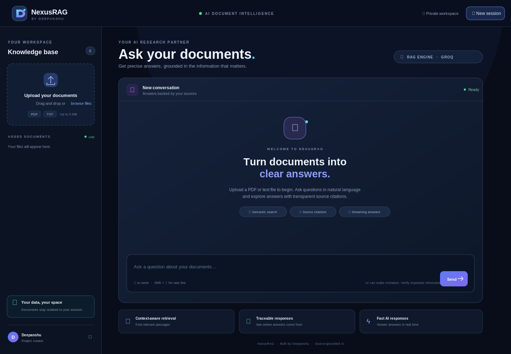

<div align="center">

# DocuMind AI

**Chat with your documents. Every answer cites its source.**

A document-grounded RAG assistant: upload PDF/TXT files, ask questions, get streamed answers with file/page/chunk citations, and an honest "I don't know" when the documents don't have the answer.



</div>

## Features
- **Cited answers**: every response lists the retrieved passages (file, page, chunk) and highlights the ones it cited
- **Hallucination guard**: answers only from retrieved context; otherwise says it doesn't know
- **Streaming UI**: token-by-token responses over Server-Sent Events
- **Multi-user safe**: per-session document indexes and chat history (no shared global state)
- **Secure uploads**: PDF/TXT only, 5 MB limit, content-type and magic-byte checks
- **Reliable**: rate limiting, API timeouts, retry with exponential backoff, JSON request-latency logs

## Tech stack
Flask · Groq LLM API · sentence-transformers (`bge-small-en-v1.5`, runs locally) · FAISS · pypdf · pytest · ruff · GitHub Actions · Docker · gunicorn/waitress

## How it works
`Upload → validate → extract text → chunk (500 tokens, 50 overlap) → embed → FAISS index (per session)`
`Question → embed → top-5 retrieval → grounded prompt + chat history → Groq (streamed) → answer + citations`

## Quick start
```bash
git clone https://github.com/DeepanshuTolani/rag-assistant && cd rag-assistant
python -m venv .venv && .venv\Scripts\activate        # Linux/Mac: source .venv/bin/activate
pip install -r requirements.txt
cp .env.example .env                                   # Windows: copy .env.example .env
# edit .env: set GROQ_API_KEY, SECRET_KEY, GROQ_MODEL (a chat model from your Groq account)
gunicorn -c gunicorn.conf.py wsgi:app                  # Windows: pip install waitress && waitress-serve --port=8000 wsgi:app
```
Open http://localhost:8000. Or run `docker compose up --build`.

## Testing
```bash
pip install -r requirements-dev.txt
pytest -q && ruff check .
```
69 tests cover chunking, retrieval, upload validation, API error handling, LLM retries, and the evaluation metrics. CI runs ruff and pytest on every push.

## Evaluation & benchmarking
`eval/` and `bench/` include a retrieval/answer/citation/refusal evaluation harness (with a no-RAG baseline) and a load-testing tool. No benchmark results are published here: figures are only reported after running them. See [docs/DETAILS.md](docs/DETAILS.md) for methodology, API reference and limitations.

## Limitations
In-memory sessions (single worker, lost on restart) · no OCR for scanned PDFs · citations are model-generated markers mapped to retrieved chunks.

## Security
Secrets come from environment variables only; `.env` is git-ignored.
